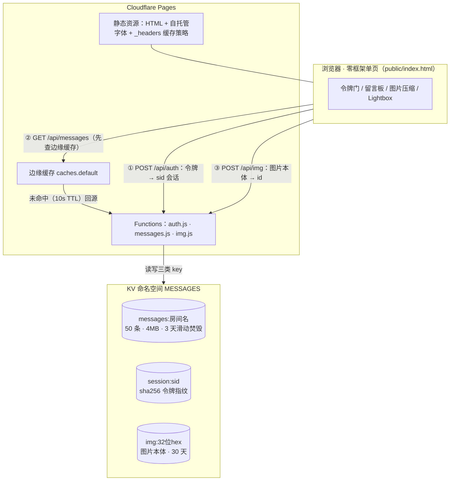
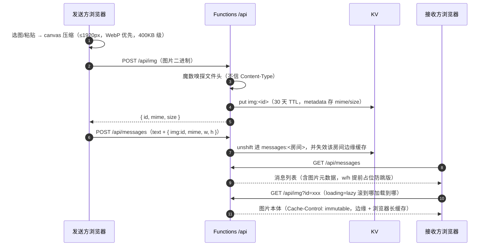

<div align="center">

# 📮 note220 · 快传板

**免登录的跨设备传输板 —— 陌生电脑 ↔ 手机之间传文字、代码、图片，朋友之间快速递东西，不用登录 QQ/微信**

*No login. No install. Just a link.*


[快速开始](#-快速开始) · [架构总览](#-架构总览) · [功能全景](#-功能全景) · [深入细节](#-深入细节) · [部署](#-部署上线-cloudflare)

</div>

---

## 这是什么

> **不注册、不装 App、不扫码 —— 一个共知令牌进门，一条链接递东西。**

在别人的电脑上想给自己发段代码？想给朋友递个文件链接又不想加微信？note220 就是干这个的：部署在 Cloudflare Pages + KV 上的自用快传板，**无账号系统，门口令牌放行**。固定房间名当常驻留言板用，随机房间名做一次性传输管道（origin：note.ms 替代品）。

三个文件就是整个后端（`auth.js` / `messages.js` / `img.js`），前端是零框架单文件 HTML，全部状态活在 URL hash 和 KV 里 —— fork 下来 10 分钟就能有自己的一个。

**四大设计支柱：**

| 支柱 | 做法 | 落点 |
|---|---|---|
| 🔑 **令牌门口制** | 无账号，令牌换 32 位随机会话；cookie 不存令牌原文，KV 存 `sha256(令牌)` 指纹，改令牌 = 全会话失效 | `functions/api/auth.js` |
| 🔗 **链接即房间** | URL 带 `#r=房间名` 即独立消息流，发链接 = 分享房间；服务端正则白名单防野 key | `functions/api/messages.js` |
| ⚡ **秒进** | `<head>` 里预取首屏数据、GET 走边缘缓存（10s，POST 主动失效）、字体自托管 swap 异步加载 —— 国内不再被 Google Fonts 白屏卡死 | `public/index.html` + `functions/api/messages.js` |
| 🔥 **不留底** | 房间 3 天没人发言整间焚毁（活跃续期）；图片 30 天自然过期；「退出」即刻吊销会话 | `wrangler.toml` KV TTL |

## 🏗️ 架构总览



## ✨ 功能全景

- 🔗 **多房间** — URL 带 `#r=房间名` 即独立房间，点房间名换房/开新房；固定名当留言板，随机名做一次性管道
- 🔑 **免登录会话** — 输一次令牌拿 32 位 sid；默认 30 分钟过期（陌生电脑友好），勾「记住我」1 年免输，随时「退出」吊销
- 🖼 **图片消息** — 插图按钮或 Ctrl/⌘+V 直接粘贴截图；前端自动压缩（最长边 1920px，WebP 优先，GIF 原样直传，按 EXIF 摆正方向）；服务端魔数嗅探；列表懒加载缩略图 + 点击全屏 Lightbox + 原图下载
- 🗑 **消息撤回** — 每条消息一键删除，全员可删（房间共用，confirm 防误触）；带图消息连图片本体一起清；服务端同步失效边缘缓存
- 📄 **大代码片段** — 单条上限 10 万字符（约一个完整源文件）；超 6 行或 2000 字自动折叠，预览露前 6 行，展开时才注入全文 DOM（防卡顿），「复制」一键拿走全文
- ⚡ **秒进体验** — 首屏请求提前到 `<head>` 并行发起；GET 结果边缘缓存 10 秒、发消息后主动失效；IBM Plex Sans + JetBrains Mono 自托管，`font-display: swap` 渲染零阻塞
- 🔥 **自动焚毁** — 房间 3 天没人发言整间清空（活跃房间每次发言续期），敏感内容不永久留底
- 🪪 **昵称身份** — 首次访问随机分名，点名字可改，接收方认得出是谁发的
- 🧰 **顺手细节** — 相对时间、Ctrl+Enter 快速发送、URL 自动链接、最新在顶 + 输入框在顶、亮色 Swiss 界面（stone 暖灰 + 深墨黑 CTA，触控目标与对比度过 a11y 基线）

## 🧱 技术栈

| 层 | 选型 | 说明 |
|---|---|---|
| 前端 | 原生 HTML/CSS/JS 单文件 | 无框架、无构建、无运行时依赖 |
| 字体 | IBM Plex Sans ×5 + JetBrains Mono ×3 | Google Fonts latin 子集 woff2 自托管 |
| 后端 | Cloudflare Pages Functions | 3 个 API 文件，按文件路径即路由 |
| 存储 | Cloudflare KV | 消息 / 会话 / 图片 三类 key |
| 缓存 | `caches.default` 边缘缓存 + `_headers` | 动态 10s 短缓存，静态 1 年 immutable |

## 📁 项目结构

```
note220/
├── public/
│   ├── index.html        # 前端单页：令牌门 + 留言板 + 图片压缩/预览 + 全部 JS（~1200 行）
│   ├── fonts.css         # 自托管字体声明表（font-display:swap，异步加载不阻塞渲染）
│   ├── fonts/            # 8 个 woff2（IBM Plex Sans ×5 + JetBrains Mono ×3，latin 子集）
│   └── _headers          # 静态缓存策略：字体 1 年 immutable，fonts.css 1 天
├── functions/api/
│   ├── auth.js           # POST/DELETE /api/auth — 令牌换随机会话、退出吊销
│   ├── messages.js       # GET/POST /api/messages — 按房间读写 KV + 边缘缓存
│   └── img.js            # POST/GET /api/img — 图片上传与读取（魔数嗅探 + immutable 缓存）
├── wrangler.toml         # Cloudflare 配置（KV 绑定 + 部署输出目录）
├── package.json          # dev / deploy 脚本
└── README.md
```

---

## 🚀 快速开始

### 本地开发（1 分钟跑起来）

```bash
npm install
npm run dev
```

打开 http://localhost:8788 ，令牌输 `devtoken` 即可。改代码自动热重载（`dev` 脚本 = `wrangler pages dev ./public --kv MESSAGES -b ROOM_TOKEN=devtoken`）。

### 部署上线（Cloudflare）

> 把项目从 fork 到上线、每步的坑都标好了，完整流程见下方 [部署上线（Cloudflare）](#-部署上线-cloudflare) 章节，约 10 分钟。日常更新只需 `git push`，Cloudflare 自动重新部署。

## 📖 深入细节

### 图片消息链路（本次更新的核心机制）

图片本体**绝不写进消息 JSON** —— 否则进房间一次要拉十几 MB，「秒进」直接报废。消息里只挂百字节级元数据，本体走独立通道：



### 数据结构（KV 三类 key）

| key | value | TTL |
|---|---|---|
| `messages:<房间名>` | JSON 数组（最新在前）：`[{id, text, name, color, ts, img?, mime?, w?, h?}, …]`，单条 ≤10 万字符、每房间 50 条、总长 ≤4MB | 3 天滑动 |
| `session:<sid>` | `sha256(ROOM_TOKEN)` 指纹（**不存令牌原文**） | 30 分钟 / 1 年 |
| `img:<32位hex>` | 图片本体 ArrayBuffer + metadata `{mime, size, ts}` | 30 天 |

```json
[
  {
    "id": "a3f9b1c2...",
    "text": "npm install 半天卡住的同学看这个 config：…",
    "name": "老王",
    "color": "hsl(123, 65%, 55%)",
    "ts": 1697000000,
    "img": "9f8e7d6c5b4a3210fedcba9876543210",
    "mime": "image/webp",
    "w": 1280,
    "h": 720
  }
]
```

新留言 `unshift` 到数组头，`slice(0, 50)` 滚动裁剪；超 4MB 时从最旧的开始丢。被裁出 50 条窗口的消息，其图片 key 会自然过期，无需手动清理。

### API

| 方法 | 路径 | 鉴权 | 作用 |
|------|------|------|------|
| GET | `/` | — | 静态前端 |
| POST | `/api/auth` | — | 校验令牌，签发随机 sid，body `{token, remember}`（默认 30 分钟 / 记住我 1 年） |
| DELETE | `/api/auth` | — | 退出：吊销当前会话 + 清 cookie |
| GET | `/api/messages?room=xxx` | cookie | 返回 `{room, messages[]}`（边缘缓存 10s，浏览器侧 no-store） |
| POST | `/api/messages` | cookie | 追加一条，body `{room, text, name, color, img?, mime?, w?, h?}` |
| DELETE | `/api/messages?room=xxx&id=yyy` | cookie | 撤回指定消息（全员可删），带图消息顺带清图片本体 |
| POST | `/api/img` | cookie | 上传图片二进制（≤2.5MB，jpeg/png/webp/gif），返回 `{id, mime, size}` |
| GET | `/api/img?id=xxx[&dl=1]` | cookie | 取图；`dl=1` 带 attachment 头触发下载；1 年 immutable 缓存 |

### 性能设计（为什么它能「秒进」）

- **首屏**：首屏数据请求在 `<head>` 里发起，与样式/字体/HTML 解析完全并行，省掉「下载完 HTML 才开始请求 API」的一整个来回
- **字体**：`media` 交换技巧异步加载 + `font-display: swap` —— 先用系统字体立刻出内容；不再请求 fonts.googleapis.com（国内重灾区，整页白屏的最大元凶）
- **读路径**：GET 结果写边缘缓存（本节点直接回，不打 KV），TTL 仅 10 秒；缓存查询放在 `checkAuth` **之后**，未登录请求绝不回数据；发给浏览器的响应始终 `no-store`，防止「发完消息重拉列表看不到新留言」
- **写路径**：POST 成功后立刻 `caches.default.delete` 失效该房间缓存，刷新即见新数据
- **图片**：元数据（百字节）与本体（KB 级）分离；本体 id 即指纹、内容永不变化，浏览器与边缘放心 1 年 immutable
- **长文**：渲染时只渲染预览，展开时才把全文 escape + linkify 注入 DOM —— 折叠判断行数优先（>6 行）+ 字符兜底（>2000 字，拦压缩 JS/base64 这种一整行没换行的）

### 安全边界

- **会话与令牌分离**（为陌生电脑设计）：cookie 只存 32 位随机 sid，**不存令牌原文**；KV 会话掺 `sha256(令牌)` 指纹，改令牌 = 全部旧会话自动失效；「退出」即刻吊销单会话
- cookie 为 `HttpOnly`（JS 读不到，防 XSS 偷）+ `Secure` + `SameSite=Lax`（防基本 CSRF）；陌生电脑默认 30 分钟过期
- 房间名服务端正则白名单（1-32 位字母/数字/`-`/`_`），图片 id 同样 32 位 hex 白名单校验，防写出野 key
- 图片上传**魔数嗅探文件头**，且必须与声明的 Content-Type 一致 —— 不信客户端自报的类型
- 用户文本服务端截断（单条 10 万字符、每房间总长 4MB），输出前端先 HTML escape 再做 URL 自动链接，防 XSS
- 服务器端常量时间比较令牌，防时序攻击（寝室场景其实用不到，养成习惯）
- **诚实声明的软肋**（自用系统取舍）：
  - 房间是软隔离 —— 拿到令牌的人可以访问任意房间名，随机房间名只是「不猜就看不见」
  - 身份可伪造 —— 昵称纯客户端自报、无认证，别在这里传救命级别的东西
  - 图片按 id 寻址 —— id 是 32 位随机 hex 猜不出来，但拿到消息就能拿到 id，与房间同一信任级别
  - `/api/auth` 未设防爆破（令牌请用足够长的随机串）、并发发消息存在后写覆盖丢消息窗口（KV 最终一致）、无速率限制

## 🛠️ 配置与调参

### 环境变量 / 绑定

| 名称 | 类型 | 必填 | 说明 |
|---|---|---|---|
| `ROOM_TOKEN` | Pages Secret | ✅ | 进门令牌，用 CLI 写入（见部署第 5 步） |
| `MESSAGES` | KV 绑定 | ✅ | `wrangler.toml` 里的 `kv_namespaces`，存全部数据 |

### 常量速查表（想改行为改这里）

| 常量 | 位置 | 默认值 | 含义 |
|---|---|---|---|
| `SESSION_SHORT` | `functions/api/auth.js` | 30 分钟 | 陌生电脑会话寿命 |
| `SESSION_REMEMBER` | `functions/api/auth.js` | 1 年 | 「记住我」会话寿命 |
| `ROOM_TTL` | `functions/api/messages.js` | 3 天 | 房间自动焚毁（滑动） |
| `MAX` | `functions/api/messages.js` | 50 | 每房间保留条数 |
| `MAX_TEXT` | `functions/api/messages.js` | 100 000 | 单条文本字符上限 |
| `TOTAL_LIMIT` | `functions/api/messages.js` | 4MB | 单房间总长护栏 |
| `EDGE_TTL` | `functions/api/messages.js` | 10 秒 | GET 边缘缓存时长 |
| `MAX_BYTES` | `functions/api/img.js` | 2.5MB | 单图上传上限（前端已压到 400KB 级，这是护栏） |
| `IMG_TTL` | `functions/api/img.js` | 30 天 | 图片自动过期 |

其他想改的：**改令牌** → 重新跑部署第 5 步的 secret 命令 + Retry deployment（全部旧会话自动失效，所有设备重输）；**要加 Markdown** → 前端加 markdown-it（注意顺序：先 escape 再 markdown 再 linkify，防 XSS）；**被 4MB 全量拉取拖慢** → 改两段式加载（列表只回 500 字预览 + 单条详情接口）；**消灭并发丢消息** → 迁 D1，append 型 INSERT 顺带解决。

## 🚢 部署上线 Cloudflare

下面是 fork 到能用的最短路径，**每一步都标了坑**，照着走就行。

### 0. Fork & Clone

在 GitHub 上 fork 本仓库，然后：

```bash
git clone https://github.com/<你的用户名>/note220.git
cd note220
```

### 1. 安装 wrangler 并登录

```bash
npm install -g wrangler
wrangler login      # 浏览器弹出 Cloudflare 登录页
```

### 2. 创建 KV 命名空间

```bash
wrangler kv namespace create MESSAGES
```

输出形如 `id = "2a483d71..."`，**复制这个 id**。

### 3. 改 wrangler.toml

```toml
name = "note220"                              # 项目名（建议保持，与 Pages 项目名一致）
[[kv_namespaces]]
binding = "MESSAGES"
id = "2a483d7164fa4dcc899adf1348cf9930"       # ← 换成第 2 步拿到的 id
```

改完 commit & push。

### 4. 创建 Pages 项目（⚠️ 最容易走错的一步）

> **关键坑**：新版 Dashboard 把入口合并到「Create application」，会默认带进 **Workers Builds 向导** —— 不要走那个！它的自动 API token 缺 `Pages:Edit` 权限，部署会报 `Authentication error [code: 10000]`。**必须走 Pages 经典的 Connect to Git 流程**。

正确路径：

1. Cloudflare Dashboard → 左侧 **Workers & Pages**
2. 顶部点 **Create** 按钮
3. 弹窗里**选「Pages」标签**（不是 Workers！）
4. 点 **Connect to Git**
5. 选你 fork 的 GitHub 仓库（首次会要授权 GitHub）
6. 点 **Begin setup**，逐字段填：

| 字段                       | 填什么                                         |
| -------------------------- | ---------------------------------------------- |
| **Project name**           | `note220`（和 wrangler.toml 的 name 保持一致） |
| **Production branch**      | `main`（你 repo 的主分支）                     |
| **Framework preset**       | `None`                                         |
| **Build command**          | **留空**（纯静态 + Functions，无构建步骤）     |
| **Build output directory** | `public`                                       |

7. **不要在这里加 Environment variables**——见下一步为什么
8. 点 **Save and Deploy**

部署会自动跑起来（约 30 秒）。完成后你会拿到一个 `https://note220.pages.dev` 之类的域名，**此时访问会显示令牌输入页，但输什么都会报错**——因为 ROOM_TOKEN 还没设。继续下一步。

### 5. 设置进门令牌（⚠️ 第二个坑）

> **关键坑**：repo 里有 `wrangler.toml`（含 `pages_build_output_dir`）时，**toml 是项目配置的唯一事实来源，Dashboard 向导里填的变量会被 toml 屏蔽，传不进 Functions**。所以 `ROOM_TOKEN` 必须用 CLI 写成 secret（secret 不受 toml 屏蔽）：

```bash
npx wrangler pages secret put ROOM_TOKEN --project-name note220
# 提示时输入令牌，看到 "✨ Success!" 即可
```

**令牌强度建议**：别用 `220` 这种 3 位纯数字，公网几秒就能 brute force。用 `dorm4-220`、`note-220` 这种 6-8 位混合串。

### 6. 触发重新部署（让 secret 生效）

> **关键坑**：Pages secret 是部署时注入的，**写完必须重新部署一次才生效**，否则访问还是 500。

任选一种触发：

- **Dashboard**：note220 项目 → Deployments → 最近一次部署右侧「⋯」→ **Retry deployment**
- **或本地**：随便改点东西 `git push`（自动触发新部署）

状态变绿后刷新域名输令牌，**能进留言板就成了**。

<details>
<summary><b>🔧 常见报错排查（点击展开）</b></summary>

| 报错 | 原因 | 解法 |
|---|---|---|
| `Authentication error [code: 10000]` | 走了 Workers Builds 向导，token 缺 `Pages:Edit` | 删项目，按第 4 步走 Pages → Connect to Git |
| HTTP 500（进不去） | `ROOM_TOKEN` 没设，或设了没重新部署 | 第 5 步写 secret + 第 6 步 Retry |
| HTTP 401（令牌不对） | 输入与 secret 不匹配 | 重跑第 5 步命令，输入正确值再 Retry |
| 部署成功但 404 / 旧版 | CDN 缓存 | 等 1-2 分钟或 Ctrl+F5 |

</details>

## 🗺️ Roadmap

- [x] 多房间 / 免登录会话 / 自动焚毁 / 大代码片段折叠
- [x] 🖼 图片消息：粘贴上传、前端压缩、懒加载、全屏预览、原图下载
- [x] ⚡ 秒进三件套：`<head>` 预取 + 边缘缓存 + 自托管字体
- [x] 亮色 Swiss 视觉重写（stone 色板 + Plex/Mono，过 a11y 基线）
- [x] 🗑 消息撤回（全员可删，带图连本体一起清）
- [ ] Markdown 渲染（先 escape 再 markdown 再 linkify）
- [ ] 两段式加载：列表只回预览 + 单条详情接口按需拉全文
- [ ] KV 迁 D1：append 写顺带消灭并发丢消息窗口

---

<div align="center">

**自用小工具，随手造的 —— 觉得有用就拿去 fork。**

 MIT License © 2026 [Weather-Report](./LICENSE)

⭐ 觉得不错点个 Star · 🐛 撞见坑欢迎提 Issue

</div>
